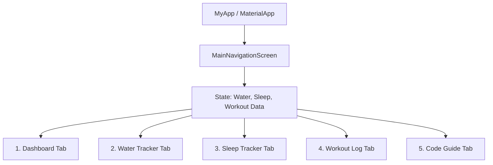

# 📱 เอกสารอธิบายโค้ดและวิธีเปิดแอป Health Tracker

เอกสารนี้จัดทำขึ้นเพื่ออธิบายโครงสร้าง สถาปัตยกรรม โมเดลข้อมูล ตรรกะการทำงาน (Logic) ทั้งหมดของแอปพลิเคชัน **Health Tracker** รวมถึงขั้นตอนและคำสั่งในการเปิดแอปพลิเคชันขึ้นมาทดสอบและตรวจสอบผลงาน

---

## 🚀 1. วิธีเปิดแอปพลิเคชันขึ้นมาเช็ค (How to Run the App)

คุณสามารถเปิดแอปนี้ขึ้นมาทดสอบได้หลากหลายวิธีตามความสะดวก:

### วิธีที่ 1: เปิดบน Web Browser (Google Chrome / Edge) — ⚡ แนะนำ รวดเร็วที่สุด
เปิด Terminal หรือ PowerShell ที่โฟลเดอร์โปรเจกต์ (`c:\Users\Windows 11\health_app`) แล้วรันคำสั่ง:
```bash
flutter run -d chrome
```
*หรือเปิดบน Microsoft Edge:*
```bash
flutter run -d edge
```
> ระบบจะเปิดหน้าต่างเบราว์เซอร์พร้อมแสดงหน้าจอแอปพลิเคชันขึ้นมาทันที

---

### วิธีที่ 2: เปิดเป็น Windows Desktop Application (Native)
รันเป็นโปรแกรม Desktop บนเครื่อง Windows:
```bash
flutter run -d windows
```
> เหมาะสำหรับการทดสอบประสิทธิภาพแบบ Native Application บนเครื่อง PC

---

### วิธีที่ 3: เปิดผ่าน VS Code หรือ Antigravity IDE (GUI)
1. เปิดโฟลเดอร์โปรเจกต์ใน IDE
2. กดปุ่ม **`F5`** หรือไปที่เมนู **Run -> Start Debugging**
3. คุณสามารถเลือก Device ที่ต้องการรัน (Chrome, Windows, หรือ Android Emulator) ได้ที่มุมขวาล่างของหน้าต่างโปรแกรม

---

### ⌨️ คีย์ลัดขณะที่แอปรันอยู่ (Terminal Shortcuts)
เมื่อรันคำสั่ง `flutter run` สำเร็จแล้ว สามารถกดปุ่มบนคีย์บอร์ดใน Terminal ได้ดังนี้:
- **`r`** : **Hot Reload** — อัปเดตการเปลี่ยนแปลงของโค้ดและ UI ทันทีโดยไม่ต้องเริ่มใหม่ และไม่สูญเสียข้อมูลสถานะ (State)
- **`R`** : **Hot Restart** — รีเซ็ตสถานะและรีสตาร์ตแอปใหม่ทั้งหมด
- **`q`** : **Quit** — ออกจากการรันแอปพลิเคชัน

---

## 🏗️ 2. โครงสร้างสถาปัตยกรรม (System Architecture)

แอปพลิเคชันใช้การออกแบบสถาปัตยกรรมแบบ **Single-Source-of-Truth** บนฐานของ **Flutter Material 3**:



### ทำไมถึงเลือกสถาปัตยกรรมนี้?
1. **IndexedStack Navigation**: สลับหน้าจอทั้ง 5 หน้าโดยไม่ทำลาย Widget State ในหน่วยความจำ ทำให้เมื่อผู้ใช้สลับจากหน้าบันทึกน้ำไปหน้าการนอน แล้วกลับมา ข้อมูลและตำแหน่ง Scroll จะยังคงอยู่ครบถ้วน
2. **Centralized State in State**: ตัวแปรสถานะทั้งหมดถูกเก็บไว้ที่ `_MainNavigationScreenState` ทำให้การอัปเดตในแท็บใดแท็บหนึ่ง (เช่น ดื่มน้ำเพิ่ม +500ml) จะสะท้อนกลับมายังแดชบอร์ดทันทีเมื่อกด `setState()`
3. **Zero External Dependencies**: ไม่พึ่งพา Library ภายนอกที่ไม่จำเป็น ทำให้โปรเจกต์คอมไพล์ผ่าน 100% ปราศจากปัญหา Version Mismatch

---

## 📦 3. โครงสร้างข้อมูล (Data Models)

มีคลาสโมเดลข้อมูลหลัก 3 คลาสใน `lib/main.dart`:

### 3.1 `WaterLog`
เก็บบันทึกประวัติการดื่มน้ำแต่ละครั้ง
```dart
class WaterLog {
  final int amount;   // ปริมาณน้ำ (ml)
  final DateTime time; // เวลาที่บันทึก
  WaterLog({required this.amount, required this.time});
}
```

### 3.2 `SleepRecord`
เก็บบันทึกข้อมูลการนอนหลับ
```dart
class SleepRecord {
  final TimeOfDay bedTime;  // เวลาเข้านอน
  final TimeOfDay wakeTime; // เวลาตื่นนอน
  final double hours;       // ชั่วโมงการนอน (คำนวณอัตโนมัติ)
  final String quality;     // คุณภาพการนอน (ดีเยี่ยม, พอใช้, น้อยเกินไป)
  final DateTime date;      // วันที่บันทึก
  ...
}
```

### 3.3 `WorkoutRecord`
เก็บบันทึกข้อมูลการออกกำลังกาย
```dart
class WorkoutRecord {
  final String category;       // กลุ่มกล้ามเนื้อ (Push, Pull, Legs)
  final String exercises;      // ท่าฝึกและรายละเอียดเซต
  final int durationMinutes;  // ระยะเวลาฝึก (นาที)
  final DateTime date;         // วันที่บันทึก
  ...
}
```

---

## ⚡ 4. รายละเอียดตรรกะและอัลกอริทึม (Feature Logic)

### 4.1 แดชบอร์ด (Dashboard)
- **คำนวณเปอร์เซ็นต์น้ำดื่ม**:
  ```dart
  final waterPercent = (_currentWater / _waterGoal).clamp(0.0, 1.0);
  ```
  ใช้ `.clamp(0.0, 1.0)` เพื่อป้องกันไม่ให้ Progress Bar ล้นหน้าจอเมื่อผู้ใช้ดื่มน้ำเกินเป้าหมาย
- **คำนวณเวลารวมออกกำลังกาย**:
  ```dart
  final totalWorkoutMins = _workoutRecords.fold<int>(0, (sum, item) => sum + item.durationMinutes);
  ```
- **คะแนนภาพรวมสุขภาพรายวัน (Health Score Indicator)**:
  เฉลี่ยค่าน้ำดื่ม + การนอนหลับพักผ่อน (>= 7 ชม.) + การออกกำลังกาย

### 4.2 การดื่มน้ำ (Water Tracker)
- **`_addWater(amount)`**: เพิ่มค่าน้ำเข้า `_currentWater` และแทรกบันทึกประวัติ `WaterLog` รายการใหม่ไว้บนสุดของ List (`_waterLogs.insert(0, ...)`)
- **Quick Buttons**: ปุ่มด่วน +100ml, +250ml, +500ml
- **`_resetWater()`**: กล่องข้อความแจ้งเตือน (`AlertDialog`) ยืนยันก่อนรีเซ็ตค่าน้ำกลับเป็น 0

### 4.3 การนอนหลับ (Sleep Tracker)
- **อัลกอริทึมคำนวณเวลานอนข้ามคืน (Overnight Calculation)**:
  ```dart
  double _calculateHours(TimeOfDay start, TimeOfDay end) {
    final startMinutes = start.hour * 60 + start.minute;
    final endMinutes = end.hour * 60 + end.minute;
    int diff = endMinutes - startMinutes;
    if (diff <= 0) {
      diff += 24 * 60; // จัดการกรณีเข้านอนตอนดึกและตื่นนอนในวันถัดไป
    }
    return double.parse((diff / 60.0).toStringAsFixed(1));
  }
  ```
- เรียกใช้ Native `showTimePicker` สำหรับเลือกเวลาเข้านอนและตื่นนอน

### 4.4 การออกกำลังกาย (Workout Log)
- **Template Auto-fill**: รองรับโปรแกรม Push / Pull / Legs โดยเมื่อแตะเลือกจะใส่ท่าฝึกเริ่มต้นลงใน `TextEditingController` อัตโนมัติ
- **History Management**: บันทึกรายการฝึกใหม่และสามารถลบรายการได้ (`_deleteWorkout(index)`)

---

## 📖 5. หน้าอธิบายโค้ดในตัวแอป (In-App Code Guide)

ได้ทำการสร้างหน้าจอ `CodeGuideScreen` (อยู่ในไฟล์ `lib/code_guide_screen.dart`) บรรจุอยู่ในแท็บที่ 5 ของแอปพลิเคชัน:
- มี Filter Chips สำหรับเลือกดูเฉพาะหัวข้อ (สถาปัตยกรรม, Data Models, ฟังก์ชัน, วิธีเปิดแอป)
- มีบล็อก Code Snippets แบบ Dark Theme ไฮไลต์ชัดเจน
- สามารถกดปุ่มสลับไปยังแท็บอื่นๆ ได้โดยตรง
- มีปุ่มเข้าถึงด่วนจากทั้ง **Bottom Navigation Bar**, **Icon บน AppBar**, และ **Banner บน Dashboard**

---

## 🧪 6. ผลการตรวจสอบโค้ด (Quality & Static Analysis)

รันคำสั่งวิเคราะห์ความถูกต้องของโค้ด:
```bash
dart analyze
```
ผลลัพธ์:
```
Analyzing health_app...
No issues found!
```
> โค้ดทั้งหมดผ่านการตรวจสอบ Static Analysis ตามมาตรฐาน `flutter_lints` 100% ไม่มี Error หรือ Warning ใดๆ
