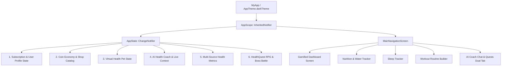

# 📱 เอกสารอธิบายโครงสร้างโค้ดและสถาปัตยกรรม HealthQuest App

เอกสารนี้จัดทำขึ้นสำหรับ Senior Flutter Developer & UX/UI Designer เพื่ออธิบายโครงสร้าง สถาปัตยกรรม โมเดลข้อมูล ตรรกะการทำงาน (Logic) ทั้งหมดของแอปพลิเคชัน **HealthQuest / Helpty App** ตาม 7 เสาหลักที่พัฒนาขึ้นใหม่

---

## 🏗️ 1. สถาปัตยกรรมระบบ (System Architecture)

แอปพลิเคชันได้รับการจัดระเบียบใหม่เป็น **Clean Modular Architecture** โดยใช้ **InheritedNotifier (AppScope)** ร่วมกับ **AppState (ChangeNotifier)** ซึ่งเป็นกลไก Reactive State Management มาตรฐานระดับ Core ของ Flutter ที่มีประสิทธิภาพสูง ไม่เกิดปัญหา Dependency Version Conflict และรองรับการอัปเดต UI แบบเรียลไทม์ทั่วทั้งแอปพลิเคชัน



---

## 📁 2. โครงสร้างโฟลเดอร์และไฟล์ (File & Directory Structure)

```
lib/
├── models/
│   └── health_models.dart         # โครงสร้างข้อมูล User, HealthData, Pet, CoinItem, Message, Boss
├── theme/
│   └── app_theme.dart             # โทนสี Deep Navy (#0F172A), Cyan, Neon Mint, Glassmorphism
├── state/
│   └── app_state.dart             # Central Reactive State (InheritedNotifier / ChangeNotifier)
├── widgets/
│   ├── source_badge.dart          # ป้ายระบุแหล่งที่มาของข้อมูล (Apple Health, Google Fit, Manual, AI)
│   ├── glass_card.dart            # การ์ดสไตล์ Glassmorphism
│   ├── pet_card_widget.dart       # วิดเจ็ตสัตว์เลี้ยง Tamagotchi ตอบสนองตามสุขภาพจริง
│   ├── quick_logging_strip.dart   # แถบบันทึกข้อมูลด่วน 1-Tap Quick Logging
│   └── rpg_status_bar.dart        # แถบค่าสถานะ HP/MP/ATK และทางเข้าสู้บอส
├── screens/
│   ├── gamified_dashboard_screen.dart # แดชบอร์ดหลักสไตล์ Gamification
│   ├── coin_shop_screen.dart          # ร้านค้า Health Shop & Rewards
│   ├── boss_battle_screen.dart        # สมรภูมิสู้บอสประจำสัปดาห์ (Solo/Co-op)
│   ├── ai_coach_screen.dart           # หน้าแชทปรึกษา AI Health Coach
│   └── premium_subscription_screen.dart # หน้าเปรียบเทียบ Free vs Pro + สลับโหมดทดสอบ
├── nutrition_tracker.dart         # ตัวบันทึกอาหารและ Macro สารอาหาร (P/C/F)
├── routine_builder.dart           # ตัวสร้างตารางเวทและระบบวิเคราะห์รูทีน AI
├── profile_history_screen.dart    # หน้ารวมประวัติสุขภาพและ Lifetime Stats
├── quest_ranking_screen.dart      # ระบบเควส RPG และลีดเดอร์บอร์ดลีก
└── main.dart                      # ทางเข้าหลักและการสลับแท็บ
```

---

## 💎 3. รายละเอียดการทำงานของ 7 ฟังก์ชันสำคัญ

### 1. Modern UI/UX Redesign
- **Visual Palette:** 
  - พื้นหลังหลัก: Deep Navy Blue (`#0F172A`)
  - สีพื้นผิวการ์ด: Slate Dark Surface (`#1E293B`) พร้อมเส้นขอบกระจกใส `Colors.white.withValues(alpha: 0.08)`
  - สีไฮไลต์: Cyan Vibrant (`#06B6D4`), Neon Mint (`#10B981`), Amber Gold (`#F59E0B`), Mystic Purple (`#8B5CF6`)
- **1-Tap Logging:** วิดเจ็ต `QuickLoggingStrip` ช่วยให้ผู้ใช้บันทึกน้ำ (+250ml, +500ml), การนอน 7.5 ชม., เวท 45 นาที หรือซิงค์สมาร์ทวอทช์ได้ในคลิกเดียว

### 2. Coin Economy & Shop System (`lib/screens/coin_shop_screen.dart`)
- **ระบบสะสมเหรียญ:**
  - ดื่มน้ำครบเป้า: `+10 Coins`
  - นอนหลับเกิน 7 ชั่วโมง: `+20 Coins`
  - ออกกำลังกายสำเร็จ: `+30 Coins`
  - สตรีคต่อเนื่อง 7 วัน: `+100 Coins`
  - ปราบบอสสำเร็จ: `+150 Coins`
- **ร้านค้า Health Shop:** มี 3 หมวดหมู่:
  1. *Pet Items:* แอปเปิ้ลออร์แกนิก, Energy Elixir, Cool Shades, Golden Crown, Cybernetic Wings (Pro Only)
  2. *App Cosmetics:* Cyberpunk Neon Theme, Emerald Forest Theme
  3. *Utility Perks:* Streak Shield (กันสตรีคหลุด 1 วัน), ตั๋วสุ่มเปิดกล่องสมบัติประจำสัปดาห์

### 3. High-Value Premium Subscription (`lib/screens/premium_subscription_screen.dart`)
- **Free Tier:** ใช้งานฟังก์ชันพื้นฐาน, เลี้ยงสัตว์เลี้ยงร่างเริ่มต้น (Baby & Teen), คุยกับ AI ได้ 5 ข้อความ/วัน
- **Pro / Premium Tier:**
  - **Unlimited AI Health Coach:** ให้คำปรึกษาไม่จำกัด พร้อมวิเคราะห์ตารางเวทและเมนูเฉพาะบุคคล
  - **Advanced Analytics & Auto-Sync:** วิเคราะห์สุขภาพขั้นสูง พร้อมซิงค์ข้อมูลกับสมาร์ทวอทช์อัตโนมัติ
  - **Exclusive Pet Evolutions:** ปลดล็อกร่างสัตว์เลี้ยงในตำนาน `Mythical Celestial Dragon 🐉✨`
  - **Multi-Device & Cloud Backup:** สำรองข้อมูลขึ้นคลาวด์แบบเรียลไทม์
- **One-Tap Switcher:** มีปุ่มสลับโหมด PRO / FREE ทั้งในแถบ Header และหน้า Premium ให้กรรมการหรือผู้ใช้ทดสอบ UX ทั้งสองแบบได้ทันที

### 4. Interactive AI Health Coach Chat (`lib/screens/ai_coach_screen.dart`)
- เพิ่มหน้าแชทกับ AI ในแท็บที่ 5 พร้อมสวิตช์สลับหน้า
- **Context-Aware Responses:** AI ตรวจสอบข้อมูลสุขภาพจริงจากแทร็กเกอร์ของผู้ใช้ (ปริมาณน้ำที่ดื่มวันนี้, ชั่วโมงนอนและคะแนนการนอนเมื่อคืน, แคลอรีที่เผาผลาญ) นำมาเป็นบริบทในการตอบคำถามอย่างตรงจุด
- **Quick Prompts:** มีปุ่มคำถามด่วน (อาหารคลีนหลังออกกำลังกาย, แก้นอนไม่หลับ, แนะนำตาราง Push/Pull/Legs, วิเคราะห์สุขภาพวันนี้)
- **ระบบจำกัดโควต้า:** Free Tier แจ้งเตือนโควต้า 5 ข้อความ/วัน เมื่อครบจะแสดง Bottom Sheet ชวนอัปเกรด Pro

### 5. Multi-Source Health Tracking & Source Labeling (`lib/widgets/source_badge.dart`)
- รองรับ Metrics ครบถ้วน: Water, Sleep, Workout, Steps & Active Calories
- แสดงป้ายกำกับแหล่งที่มาบนทุกวิดเจ็ต:
  - `[Synced via Apple Health / Google Fit]` (ไอคอนนาฬิกาสมาร์ทวอทช์ สีฟ้า)
  - `[Manual Input]` (ไอคอนมือสัมผัส สีทอง)
  - `[AI Estimated]` (ไอคอน AI สีม่วง)

### 6. HealthQuest RPG & Boss Battles (`lib/screens/boss_battle_screen.dart`)
- **แปลงสุขภาพจริงเป็นพลังต่อสู้:**
  - ดื่มน้ำ = เติม **MP** (Magic Points)
  - นอนหลับ = ฟื้นฟู **HP** (Health Points)
  - ออกกำลังกาย = เพิ่มค่า **ATK** (Attack Power)
- **Weekly Boss Battle:** สู้บอส "Lord Sloth" มีท่าโจมตี Physical Strike, Hydro Blast (ใช้น้ำ MP), Restful Barrier (ใช้การนอนกางโล่) รองรับโหมด Solo และ Co-op

### 7. Tamagotchi-Style Virtual Health Pet (`lib/widgets/pet_card_widget.dart`)
- สัตว์เลี้ยง "Lumi" ประจำตัวบนแดชบอร์ด
- **Hydration Status:** สดชื่น ✨ เมื่อดื่มน้ำพอ หรือ เหี่ยวเฉา 🥀 เมื่อขาดน้ำ
- **Energy Level:** กระปรี้กระเปร่า ⚡ เมื่อนอนเต็มอิ่ม หรือ ง่วงซึม 💤 เมื่อนอนน้อย
- **Evolution System:** 3 ร่างหลัก (Baby -> Teen -> Adult) + ร่างพิเศษ `Mythical Dragon 🐉` สำหรับ Pro Member
- **Interactivity:** กดลูบหัวเพื่อเพิ่มค่าความสุขและ EXP, ให้อาหาร, สวมใส่อุปกรณ์ตกแต่งที่ซื้อจากร้านค้า

---

## 🧪 การทดสอบระบบ (Quality Assurance)

- ทดสอบด้วย `flutter analyze` — **No issues found!**
- ทดสอบด้วย `flutter test` — **All tests passed!**
